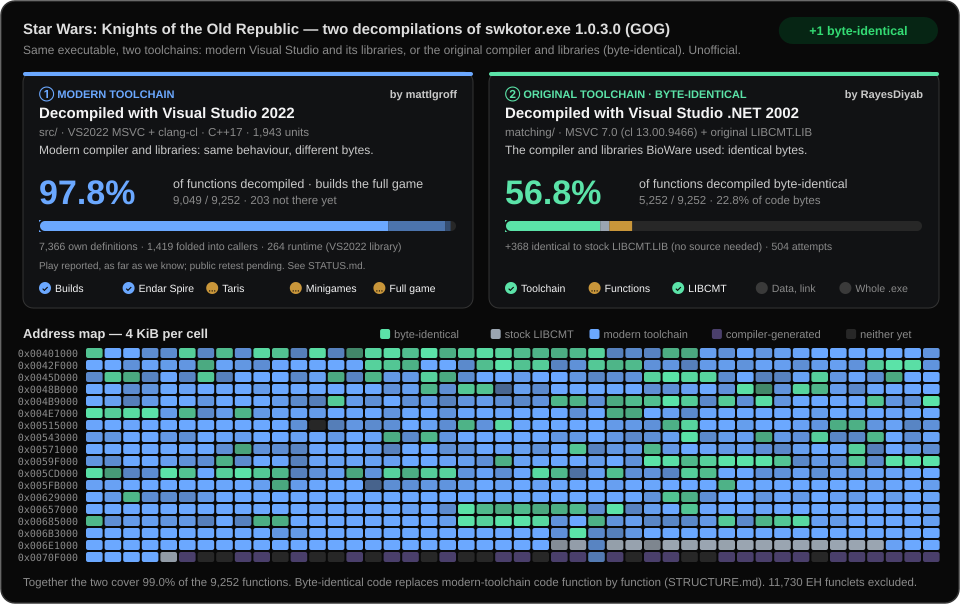

# swkotor1-reconstruction

This project reconstructs the **GOG Windows 1.03** version of **Star Wars: Knights of the Old Republic** from its executable. This repository is intended to house the reconstructed source code. You must purchase the original game and supply its assets.



This project has two decompilations of the same executable:

- `src/`: built with modern Visual Studio 2022 and its libraries. Work of [mattlgroff](https://github.com/mattlgroff).
- `matching/`: built with the original Visual Studio .NET 2002 and its libraries, so it is byte-identical. Work of [RayesDiyab](https://github.com/RayesDiyab).

See [STRUCTURE.md](STRUCTURE.md). Milestones follow [STATUS.md](STATUS.md).

## This fork

This is an unofficial fork of [mattlgroff/swkotor1-reconstruction](https://github.com/mattlgroff/swkotor1-reconstruction). It adds:

- Python tooling run through [uv](https://docs.astral.sh/uv/), linted with ruff, with its behaviour locked by golden tests.
- A bridge that compiles byte-identical matched functions from `matching/` into the playable build (`bridge_sources.py`, `src/bridge/`): 40 functions so far, each replacing playable code that implemented the same logic. See [STRUCTURE.md](STRUCTURE.md#2-the-bridge-matched-code-inside-the-playable-build).
- `bridge_gate.py`, which checks every bridged function against your own original executable by emulation (see [BUILDING.md](BUILDING.md#verify-the-bridge)).

All bridged functions pass that check, but they have not been play-tested yet. Like upstream, this fork supports only the GOG Windows 1.03 executable.

## Supported version

The project targets the English **GOG Windows 1.03** release. The original `swkotor.exe` is a 32-bit executable with file and product version **1.0.3.0** and a size of **4,042,752 bytes**.

Original executable SHA-256:

```text
9c10e0450a6eeca417e036e3cde7474fed1f0a92aab018446d156944dea91435
```

Use this hash to identify the target executable. Other releases and modified executables may differ.

## Original game required

You must separately purchase and lawfully possess the original game and supply its assets locally. This repository distributes no original game resources, proprietary binaries, middleware, or raw decompiler exports. The playable build also generates a local original-derived CRT math dependency from the supported executable; see [BUILDING.md](BUILDING.md#local-original-derived-math-dependency). Those generated code and table files are not distributed.

See [BUILDING.md](BUILDING.md) for build instructions, [STATUS.md](STATUS.md) for current progress and [CONTRIBUTING.md](CONTRIBUTING.md) for bug reports and source contributions.

## Rights and affiliation

This project is unofficial and is not affiliated with or endorsed by the game's creators, publishers, GOG, or other rights holders.

The original game, its trademarks, assets, and other third-party materials remain the property of their respective rights holders. All rights reserved by the respective rights holders. This project does not claim ownership of those rights or grant permission to redistribute proprietary game materials.

The project uses the [MIT License](LICENSE) for any rights its contributors hold. This does not grant rights to original KOTOR code, assets, trademarks, or other third-party material.
